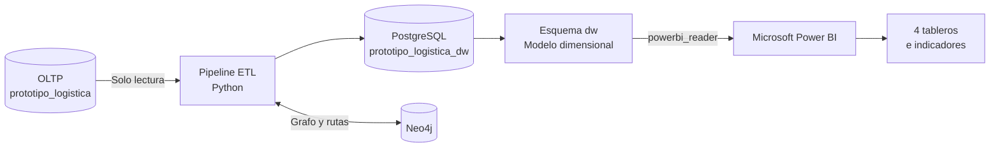

# 🚚 Prototipo Logística | Business Intelligence

**Análisis y visualización del desempeño de las operaciones logísticas con Power BI y PostgreSQL ETL.**

---

## 📌 Descripción

Prototipo Logística BI es la capa de análisis y visualización de un sistema de gestión operacional y analítica para el control y la optimización de rutas de distribución de paquetería. El informe fue desarrollado en Microsoft Power BI y consume únicamente el esquema dw de un Data Warehouse en PostgreSQL con modelo dimensional (esquema en estrella, enfoque Kimball)

Los datos son sintéticos y representan una operación de paquetería en El Salvador: 8 sucursales, 18 vehículos y 32 clientes. Se originan en una base operacional (OLTP), son procesados mediante un pipeline ETL en Python y se consolidan en el almacén de datos. Los resultados del cálculo de rutas sobre un grafo en Neo4j (escenarios base, bloqueo y congestión) también llegan al almacén.

Este repositorio contiene el archivo de Power BI, la documentación del modelo, el catálogo de indicadores, las medidas DAX y la guía para preparar el acceso de lectura al Data Warehouse.

## 📊 Vista previa
 
| Página | Captura |
|---|---|
| Operación diaria |  |
| Desempeño |  |
| Resultados |  |
| Escenarios de red |  |
 
> Las capturas corresponden al archivo `BI Logistica.pbix` de este repositorio. Los valores dependen de la corrida del ETL con la que se haya actualizado el informe.
 
## 🏗️ Arquitectura de datos

Power BI no consulta directamente la base operacional. La conexión se realiza al esquema `dw` de la base `prototipo_logistica_dw`, con un rol de solo lectura.
 

El ETL y sus componentes de extracción, transformación y carga se documentan en su propio repositorio. Este proyecto se concentra en el consumo analítico de los datos.

## 🎯 Contenido del informe
 
El informe tiene cuatro páginas, con encabezado, botones de navegación y selector de meses comunes.
 
| Página | Indicadores | Qué muestra |
|---|---|---|
| **Operación diaria** | I1 a I4 | Entregas a tiempo, incidencias, utilización de la flota y desviación de kilómetros, con tendencia de siete días, incidencias por tipo, despachos por sucursal y mapa |
| **Desempeño** | I6 a I9 | Tiempo de entrega, distancia, retraso por incidencia y combustible, por mes, sucursal, tipo de incidencia y tipo de vehículo |
| **Resultados** | R1 y R2 | Costo por despacho y por envío, por mes, sucursal y tipo de vehículo |
| **Escenarios de red** | I5 | Comparación de la ruta base con el bloqueo y la congestión, con tabla de detalle e impacto de cada contingencia |
 
Cada indicador se presenta con su valor, su meta, el porcentaje de cumplimiento y un semáforo

### Indicadores
 
| N.º | Indicador | Tipo | Meta |
|---|---|---|---|
| I1 | Entregas a tiempo (%) | PI | ≥ 90 % |
| I2 | Incidencias por 100 despachos | KPI | ≤ 17 |
| I3 | Utilización de la flota (%) | PI | 15 a 30 % |
| I4 | Desviación de kilómetros (razón) | KPI | ≤ 1.10 |
| I5 | Rutas alternativas válidas (%) | PI | 100 % |
| I6 | Tiempo promedio de entrega (h) | PI | ≤ 48 h |
| I7 | Distancia promedio por despacho (km) | PI | ≤ 110 km |
| I8 | Retraso promedio por incidencia (min) | PI | ≤ 26 min |
| I9 | Combustible por despacho (gal) | PI | Consumo esperado según km planificados |
| R1 | Costo operativo por despacho (USD) | RI | Promedio del periodo |
| R2 | Costo operativo por envío (USD) | RI | Promedio del periodo |
 
KPI: indicador clave de desempeño. PI: indicador de desempeño. RI: indicador de resultado (taxonomía de Parmenter). 
 
## 🧰 Tecnologías
 
| Tecnología | Uso |
|---|---|
| Microsoft Power BI Desktop | Modelado analítico y visualización |
| PostgreSQL | Motor de base de datos del Data Warehouse |
| Python / ETL | Procesamiento y carga de datos en el DW |
| Modelo dimensional Kimball | Organización de dimensiones y hechos |
| Neo4j | Grafo de la red vial y cálculo de rutas (en el proyecto ETL) |

## 🗄️ Modelo de datos
 
El Data Warehouse tiene 8 dimensiones, 4 tablas de hechos y un registro histórico de escenarios de rutas.
 
**Dimensiones:** `dim_tiempo`, `dim_estado`, `dim_territorio`, `dim_cliente`, `dim_sucursal`, `dim_vehiculo`, `dim_conductor`, `dim_tipo_incidencia`.
 
**Hechos:** `hecho_envios`, `hecho_despachos`, `hecho_incidencias`, `hecho_eventos`.
 
**Registro de escenarios:** `resultado_escenario` (solo inserción, sin relaciones con las dimensiones).
 
Detalle de tablas, relaciones y convenciones en [`docs/modelo_datos.md`](docs/modelo_datos.md).

## ⚙️ Configuración y conexión
 
### Requisitos
 
- Power BI Desktop.
- PostgreSQL accesible desde el equipo donde se ejecuta Power BI.
- Base `prototipo_logistica_dw` creada y poblada por el ETL.
- Permisos de administración de PostgreSQL para crear el usuario de consulta.
- Para el mapa de sucursales: permitir los objetos visuales de mapa en *Archivo → Opciones y configuración → Opciones → Seguridad* y contar con internet.

### Preparar PostgreSQL
 
Se utiliza un usuario exclusivo para Power BI, con lectura únicamente sobre el esquema `dw`.
 
📘 **[Configuración de PostgreSQL y conexión con Power BI](docs/conexion_postgresql.md)**
 
### Abrir el informe
 
1. Descarga o clona este repositorio.
2. Abre `dashboard/BI Logistica.pbix` con Power BI Desktop.
3. Ve a *Inicio → Transformar datos → Configuración del origen de datos* y cambia el servidor y la base de datos por los de tu entorno.
4. Cuando Power BI solicite credenciales, usa el usuario `powerbi_reader`.
5. Haz clic en **Actualizar**.
> **Importante:** el archivo PBIX no incluye las credenciales del servidor. Cada persona debe configurar las suyas. El modo de conectividad es **Importar**, por lo que los datos no se actualizan solos.