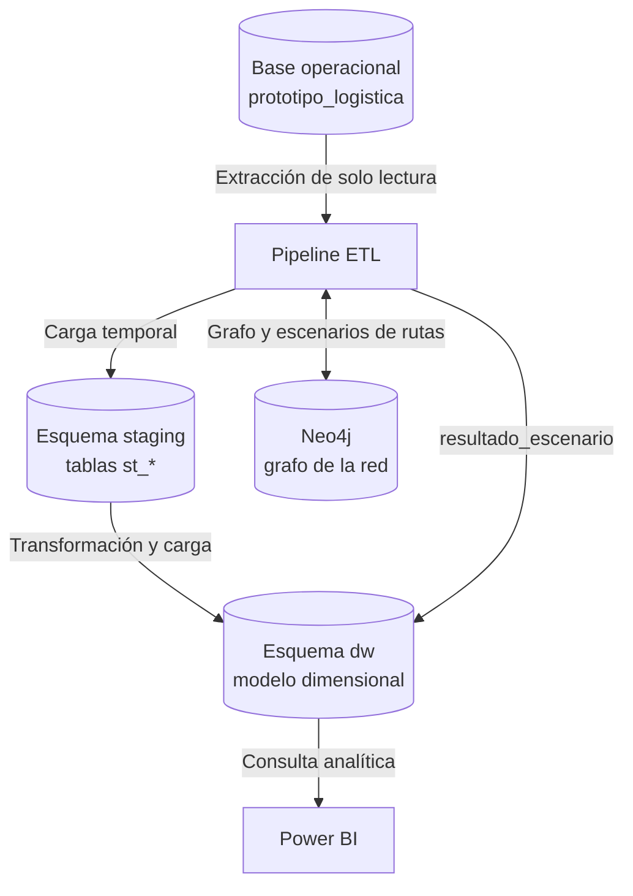

# Modelo de datos del Data Warehouse

## 1. Propósito

El informe de Power BI consume el Data Warehouse `prototipo_logistica_dw`, cuyo esquema analítico es `dw`.

El DW utiliza un modelo dimensional (Kimball) con varias tablas de hechos que comparten dimensiones (constelación de hechos). Organiza la información logística en dimensiones descriptivas y tablas de hechos medibles.

## 2. Flujo de datos



El ETL extrae los datos de la OLTP, los prepara y los carga en el DW. Power BI consume el resultado y no modifica las tablas analíticas.

## 3. Dimensiones

| Tabla | Atributos principales |
|---|---|
| `dw.dim_tiempo` | `id_tiempo` (AAAAMMDD; 0 = sin fecha), `fecha`, `anio`, `trimestre`, `mes`, `nombre_mes`, `dia_semana`, `nombre_dia`, `es_fin_de_semana` |
| `dw.dim_estado` | `id_estado_sk`, `id_estado_oltp`, `nombre_estado` |
| `dw.dim_territorio` | `id_territorio_sk`, `id_territorio_oltp`, `nombre_territorio` |
| `dw.dim_cliente` | `id_cliente_sk`, `id_cliente_oltp`, `nombre`, `tipo_cliente` (persona o empresa), `territorio_sk` |
| `dw.dim_sucursal` | `id_sucursal_sk`, `id_sucursal_oltp`, `codigo`, `nombre`, `territorio_sk`, `latitud`, `longitud` |
| `dw.dim_vehiculo` | `id_vehiculo_sk`, `id_vehiculo_oltp`, `placa`, `tipo`, `capacidad_kg`, `consumo_km_gal` |
| `dw.dim_conductor` | `id_conductor_sk`, `id_empleado_oltp`, `nombre_completo`, `numero_licencia`, `sucursal_base` |
| `dw.dim_tipo_incidencia` | `id_tipo_incidencia_sk`, `id_tipo_incidencia_oltp`, `nombre_tipo` |

`dim_cliente` y `dim_sucursal` referencian a `dim_territorio` en la base de datos. En el modelo de Power BI esas relaciones no se utilizan, porque generarían caminos ambiguos hacia `dim_territorio`.

## 4. Tablas de hechos

| Tabla | Granularidad | Medidas y atributos principales |
|---|---|---|
| `dw.hecho_envios` | Un registro por envío | `peso_kg`, `volumen_m3`, `horas_hasta_entrega`, `entregado_a_tiempo`. Dimensiones degeneradas: `codigo_guia`, `prioridad` |
| `dw.hecho_despachos` | Un registro por despacho | `numero_paradas`, `km_planificados`, `km_recorridos`, `costo_estimado`, `minutos_retraso`, `peso_asignado_kg`, `entregas_completadas`. Dimensión degenerada: `estado_despacho` |
| `dw.hecho_incidencias` | Un registro por incidencia | `minutos_retraso`. Dimensiones degeneradas: `id_despacho_oltp`, `id_envio_oltp` |
| `dw.hecho_eventos` | Un registro por evento de trazabilidad | `horas_desde_anterior`, `horas_desde_registro`, `nota`. Dimensión degenerada: `envio_oltp_id` |

Las medidas que dependen de que un proceso termine (por ejemplo `horas_hasta_entrega` de un envío no entregado, o `km_recorridos` de un despacho sin cerrar) permanecen sin valor hasta que la operación las completa.

## 5. Registro de escenarios

| Tabla | Descripción |
|---|---|
| `dw.resultado_escenario` | Una fila por ruta calculada en Neo4j en cada corrida: `escenario` (`base`, `bloqueo` o `congestion`), `origen`, `destino`, `ruta`, `km_totales`, `minutos_totales`, `tramo_afectado`, `penalizacion_min` y `calculado_en` |

A diferencia de las demás tablas, no se reconstruye en cada corrida: es un registro histórico de solo inserción. Tampoco tiene claves hacia las dimensiones, porque el origen y el destino se guardan como texto con el código de la sucursal. Si no existe ruta posible, `km_totales` y `minutos_totales` quedan sin valor, no en cero.

## 6. Convenciones del modelo

- Las columnas terminadas en `_sk` son claves subrogadas del Data Warehouse.
- Las columnas terminadas en `_oltp` conservan el identificador de la operación de origen.
- `dim_tiempo.id_tiempo` usa el formato `AAAAMMDD`. El valor `0` es el miembro «sin fecha», usado por hechos cuyo evento todavía no ocurre; así las claves foráneas nunca son nulas.
- Las fechas se almacenan en UTC en el origen y la dimensión de tiempo agrupa por día local de El Salvador.

## 7. Estrategia de actualización

| Objeto | Estrategia |
|---|---|
| Dimensiones | Carga idempotente por clave natural: solo se agregan los registros que no existen |
| Hechos | Reconstrucción completa desde `staging` en cada ejecución |
| `resultado_escenario` | Solo inserción; cada corrida agrega sus filas |
| `staging` | Se vacía al inicio de cada corrida |

Power BI debe consultar el esquema `dw`, nunca `staging`.

## 8. Relaciones en Power BI

Todas son de varios a uno, con filtro en una sola dirección (de la dimensión hacia el hecho).

| Hecho | Columna | Dimensión | Estado |
|---|---|---|---|
| `hecho_envios` | `tiempo_entrega_sk` | `dim_tiempo[id_tiempo]` | Activa |
| `hecho_envios` | `tiempo_registro_sk` | `dim_tiempo[id_tiempo]` | Inactiva |
| `hecho_envios` | `tiempo_comprometida_sk` | `dim_tiempo[id_tiempo]` | Inactiva |
| `hecho_envios` | `estado_sk` | `dim_estado[id_estado_sk]` | Activa |
| `hecho_envios` | `remitente_sk` | `dim_cliente[id_cliente_sk]` | Activa |
| `hecho_envios` | `destinatario_sk` | `dim_cliente[id_cliente_sk]` | Inactiva |
| `hecho_envios` | `sucursal_origen_sk` | `dim_sucursal[id_sucursal_sk]` | Activa |
| `hecho_envios` | `territorio_destino_sk` | `dim_territorio[id_territorio_sk]` | Activa |
| `hecho_despachos` | `tiempo_sk` | `dim_tiempo[id_tiempo]` | Activa |
| `hecho_despachos` | `sucursal_sk` | `dim_sucursal[id_sucursal_sk]` | Activa |
| `hecho_despachos` | `conductor_sk` | `dim_conductor[id_conductor_sk]` | Activa |
| `hecho_despachos` | `vehiculo_sk` | `dim_vehiculo[id_vehiculo_sk]` | Activa |
| `hecho_incidencias` | `tiempo_sk` | `dim_tiempo[id_tiempo]` | Activa |
| `hecho_incidencias` | `tipo_incidencia_sk` | `dim_tipo_incidencia[id_tipo_incidencia_sk]` | Activa |
| `hecho_eventos` | `tiempo_sk` | `dim_tiempo[id_tiempo]` | Activa |
| `hecho_eventos` | `estado_sk` | `dim_estado[id_estado_sk]` | Activa |
| `Meses` (tabla auxiliar) | `Mes` | `dim_tiempo[mes]` | Activa |

Detalles del modelo en Power BI:

- `resultado_escenario` no tiene relaciones con ninguna tabla.
- No debe haber relaciones entre tablas de hechos (por ejemplo por `hecho_id`, que solo es un consecutivo de cada tabla).
- `dim_tiempo` está marcada como tabla de fechas (columna `fecha`) y excluye el miembro «sin fecha».
- La tabla `Meses` contiene los doce meses para el selector, aunque aún no haya datos de todos.
- La tabla `Medidas` solo contiene las medidas DAX 

No se deben asumir relaciones solo por coincidencia de nombres de columnas. Verifica cardinalidad, dirección de filtro y claves antes de modificarlas.

## 9. Cómo consultar la estructura real

Para listar las tablas del esquema `dw`:

```sql
SELECT table_schema, table_name, table_type
FROM information_schema.tables
WHERE table_schema = 'dw'
ORDER BY table_name;
```

Para consultar las columnas de una tabla:

```sql
SELECT column_name, data_type, is_nullable
FROM information_schema.columns
WHERE table_schema = 'dw'
  AND table_name = 'hecho_envios'
ORDER BY ordinal_position;
```

Esta documentación debe mantenerse alineada con las migraciones vigentes del Data Warehouse.
